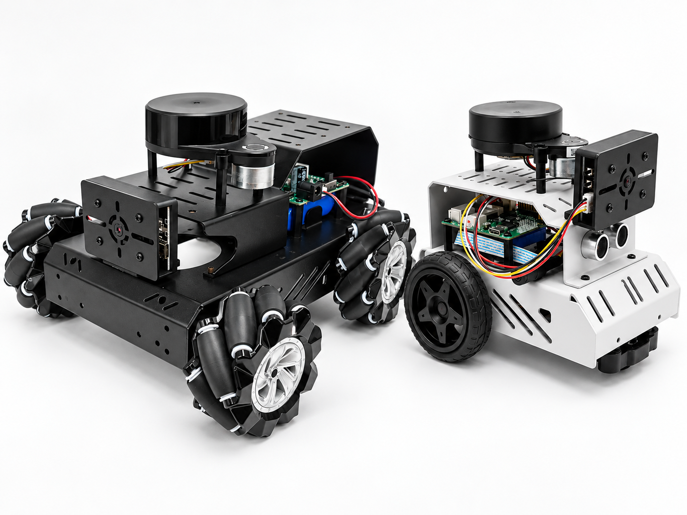

# LEAP ROS2 开源机器人

> 交流 QQ 群：`1055265929`

## 项目初衷

开源这个项目，是希望让更多学生和机器人爱好者能够用尽可能低的成本，真正动手学习当下热门的机器人技术和前沿的机器人开发框架。

现在市面上很多 ROS 机器人学习套件价格并不低，动辄几千元的成品机器人，对不少学生来说门槛太高，往往还没开始学习就已经望而却步。机器人技术本身应该是可以被更多人接触、拆解、复现和改进的，而不应该只停留在昂贵设备和成品套件里。

因此，我推出了 LEAP ROS2 开源机器人，目前提供 LEAP_ROS 和 LEAP_ROS_MAX 两种配置，参考成本分别约为 200 元和 600 元。项目尽量使用常见、容易购买、价格友好的器件，让大家可以从硬件组装、固件烧录、ROS2 环境搭建、节点通信、传感器接入、运动控制等环节一步步理解机器人系统是如何工作的。

这个项目更适合愿意动手实践的人：你可以根据开源资料自行打板、焊接、采购配件、打印外壳，也可以在现有设计基础上继续修改和扩展。希望它不仅是一台低成本小车，更是一个适合入门、教学、比赛准备和二次开发的 ROS2 学习平台。

## 配置说明

| 配置 | 说明 | 参考成本 | 单片机源码 |
| --- | --- | --- | --- |
| LEAP_ROS | 原有配置，适合低成本入门和动手实践 | 约 200 元 | [leap_ros_mcu_driver](https://github.com/czu963889306-dev/leap_ros_mcu_driver) |
| LEAP_ROS_MAX | 新增麦克纳姆轮配置，可根据需求和预算选择 | 约 600 元 | [leap_ros_max_mcu_driver](https://github.com/czu963889306-dev/leap_ros_max_mcu_driver) |

以上为制作参考成本，实际成本会随配件选型、采购渠道和采购数量变化，成品及配件售价请联系博主咨询。

## 开源内容

本仓库保留硬件相关资料，软件源码已拆分到独立仓库维护，方便按模块拉取、更新和复用。

| 模块 | 说明 | 源码仓库 |
| --- | --- | --- |
| LEAP_ROS 单片机驱动 | LEAP_ROS 配置的底层单片机控制代码 | [leap_ros_mcu_driver](https://github.com/czu963889306-dev/leap_ros_mcu_driver) |
| LEAP_ROS_MAX 单片机驱动 | LEAP_ROS_MAX 麦克纳姆轮配置的底层单片机控制代码 | [leap_ros_max_mcu_driver](https://github.com/czu963889306-dev/leap_ros_max_mcu_driver) |
| WiFi 图传 | ESP32-S3 WiFi 摄像头图传源码 | [esp32_s3_wifi_camera](https://github.com/czu963889306-dev/esp32_s3_wifi_camera) |
| ROS 功能包 | ROS2 工作空间与功能包源码 | [leap_ros_ws](https://github.com/czu963889306-dev/leap_ros_ws) |
| AI 大模型助手 | AI 大模型语音助手客户端 | [voice_assistant_client](https://github.com/czu963889306-dev/voice_assistant_client) |

本仓库主要包含以下内容：

- `硬件`：原理图、BOM 物料清单、嘉立创工程文件和 3D 打印外壳文件。
- `README.md`：项目说明和软件源码索引。

通过这些资料，你可以自行复现整套机器人，也可以只选择其中的软件或硬件部分进行学习和改造。

## 使用方式

1. 根据需求和预算选择 LEAP_ROS 或 LEAP_ROS_MAX 配置，并核对所选配置的硬件资料。
2. 根据所选配置进入对应的单片机源码仓库，再按需要获取 WiFi 图传、ROS 功能包和 AI 大模型助手代码。
3. 按各源码仓库 README 或说明文档完成编译、烧录和运行。

## 学习资料

### 通用学习资料

- 视频学习链接：[Bilibili](https://www.bilibili.com/video/BV1nNNb6cER7/?spm_id_from=333.1387.homepage.video_card.click&vd_source=339f0240733dcda285627ff53cbd145f)
- 进阶版（含主控）学习视频：[Bilibili含主控](https://www.bilibili.com/video/BV1uxp46SEoU/?vd_source=339f0240733dcda285627ff53cbd145f)

### LEAP_ROS

- 学习文档（飞书）：[LEAP_ROS 学习文档](https://my.feishu.cn/wiki/Qzl8wFIfKiksMskyEqMc02sYnXf)
- 二驱虚拟机镜像：[百度网盘](https://pan.baidu.com/s/1cjOiwqZdjTcRxwIW4gEIOg?pwd=vst7)，提取码：`vst7`

### LEAP_ROS_MAX

- 学习文档（飞书）：[LEAP_ROS_MAX 学习文档](https://my.feishu.cn/docx/Mo78dfVM3ogy5CxIhXmcVKTGnKe)
- 四驱麦轮瑞芯微镜像：[百度网盘](https://pan.baidu.com/s/13MsQBEHg_bm8DopCmByyfA?pwd=w6v5)，提取码：`w6v5`

## 适合人群

- 想低成本入门 ROS2 和机器人开发的学生。
- 想了解机器人底层硬件、固件和上层框架如何配合的初学者。
- 需要课程设计、毕业设计、竞赛原型或教学案例的同学和老师。
- 想在开源机器人平台上继续扩展视觉、导航、SLAM、机械结构或控制算法的开发者。

## 购买说明

如果你想节省打板、贴片、采购和组装的时间，也可以直接联系博主购买已经贴片好的 PCB 板、散件、配件，或者成品机器人。

### 按配置购买

| 配置 | 说明 | 淘宝购买链接 |
| --- | --- | --- |
| LEAP_ROS | 原有配置，制作参考成本约 200 元 | [购买 LEAP_ROS](https://item.taobao.com/item.htm?ft=t&id=1064850611171&spm=a21dvs.23580594.0.0.3f062c1b3ZDGGt) |
| LEAP_ROS_MAX | 麦克纳姆轮配置，制作参考成本约 600 元 | [购买 LEAP_ROS_MAX](https://item.taobao.com/item.htm?abbucket=20&id=1089241377336&mi_id=0000ET3fb_KiIW4VhASN5uTCuZD_0xEe1QxNPIAL9M1xc7E&ns=1&skuId=6313650887438&spm=a21n57.1.hoverItem.1&utparam=%7B%22aplus_abtest%22%3A%22e66b19880a8cfa4a4d7b5d141d7cffac%22%7D&xxc=qcpx) |

请根据所需配置选择对应链接，具体售价和可选配件以商品页面为准。

## 使用声明与交流

**未经允许禁止商用，本项目仅供学习、交流和研究使用。**

## 说明

本项目以学习、交流和二次开发为主要目的。由于硬件批次、元器件采购渠道、焊接质量和使用环境不同，实际效果可能会有差异。建议在动手制作前先阅读原理图、BOM 和相关源码，并根据自己的需求进行适当调整。

欢迎大家基于本项目继续改进，也欢迎反馈问题、分享经验，让这个低成本 ROS2 机器人平台变得更完善。
